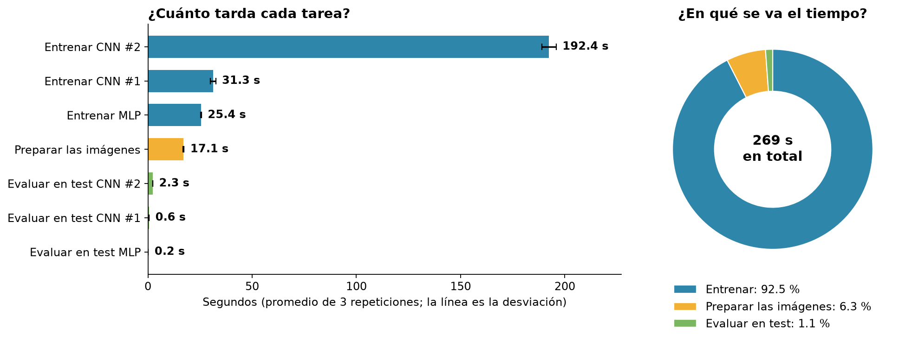
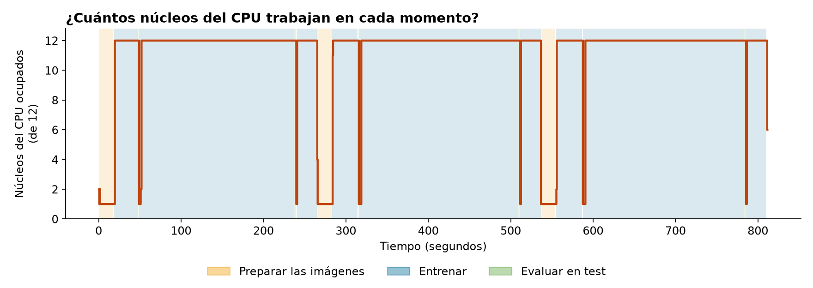
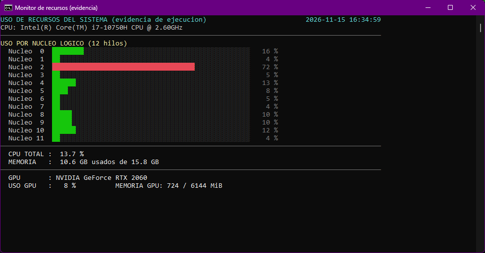
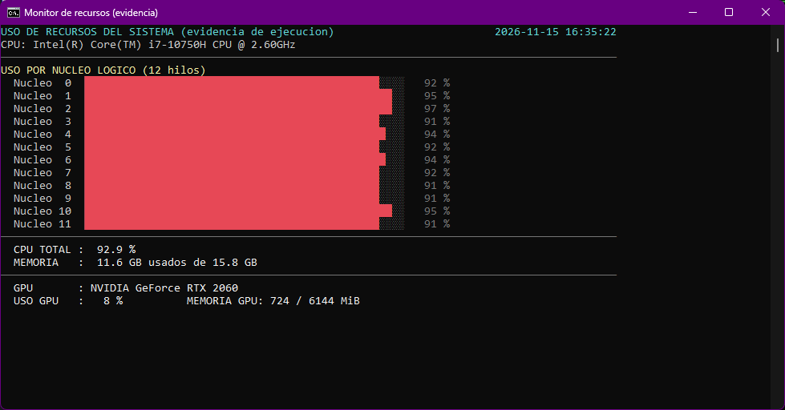

# Paso 2 — Medición del tiempo de ejecución secuencial

Se ejecutó la solución del Laboratorio 3 **sin modificar** ([`secuencial/lab3_original/`](../secuencial/lab3_original/)) y se
midió cada tarea con [`secuencial/medir_secuencial.py`](../secuencial/medir_secuencial.py).

## 2.1 Qué se midió y con qué equipo

**Conjunto de imágenes:** las 17,400 de la muestra del Lab 3 (12,180 entrenamiento, 2,610 validación, 2,610 prueba).

| Tarea | Código del Lab 3 | Imágenes |
|---|---|---:|
| Preparar las imágenes | `load_preprocessed_batch` (una por una) | 17,400 |
| Entrenar | `model.fit` de CNN #1, CNN #2 y MLP (3 épocas fijas, lote de 64) | 12,180 × 3 épocas |
| Evaluar en test | `model.evaluate` | 2,610 |

**Equipo:** Intel Core i7-10750H (6 núcleos / 12 hilos) · 15.8 GB de RAM · Windows 11 · Python 3.12 · TensorFlow 2.21.
TensorFlow en Windows nativo no usa la GPU, así que todo corre en CPU.

## 2.2 Procedimiento

1. Equipo enchufado y sin programas pesados abiertos. Antes de medir se lee una vez cada archivo, para que el disco no afecte.
2. Cada tarea se mide con `time.perf_counter()`.
3. Se **repite 3 veces** en las mismas condiciones (misma semilla, datos e hiperparámetros) y se calcula media y desviación estándar.
4. Se registra el uso de cada núcleo del CPU cada 0.5 s (`logs/resources_pc1_keras_original.csv`).

*(Un primer intento se interrumpió por falta de memoria; se cerraron programas y se repitió completo.)*

## 2.3 Resultados

Tiempo en segundos. Tabla en `results/secuencial_tabla_pc1.md`; datos crudos en `results/benchmark_pc1_keras_original.csv`.

| Tarea | Rep. 1 | Rep. 2 | Rep. 3 | **Media ± desv.** | ms por imagen |
|---|---:|---:|---:|---:|---:|
| Preparar las imágenes | 16.84 | 17.05 | 17.36 | **17.09 ± 0.26** | 0.98 |
| Entrenar CNN #1 | 29.83 | 31.97 | 32.03 | **31.27 ± 1.25** | 0.86 |
| Entrenar CNN #2 | 188.60 | 193.28 | 195.34 | **192.41 ± 3.45** | 5.27 |
| Entrenar MLP | 25.50 | 25.14 | 25.67 | **25.44 ± 0.27** | 0.70 |
| Evaluar en test CNN #1 | 0.54 | 0.58 | 0.59 | **0.57 ± 0.03** | 0.22 |
| Evaluar en test CNN #2 | 2.28 | 2.33 | 2.37 | **2.32 ± 0.04** | 0.89 |
| Evaluar en test MLP | 0.19 | 0.20 | 0.19 | **0.20 ± 0.00** | 0.08 |
| **TOTAL** | 263.78 | 270.54 | 273.55 | **269.29 ± 5.00** | |

*«ms por imagen» = tiempo medio ÷ imágenes procesadas; en entrenar incluye la validación de cada época.*

**Evidencia de ejecución** (capturas del monitor de recursos durante una corrida del mismo código; detalle en
[`results/evidencia/`](../results/evidencia/README.md)):

## 2.4 Análisis de los tiempos

* **Entrenar es el 92.5 % del tiempo** (249 de 269 s); la **CNN #2 sola es el 71 %** (192 s).
* **Preparar las imágenes es el 6.3 %** (17 s, 0.98 ms por imagen) y usa **1 núcleo de 12**; entrenar usa los 12.
* **Evaluar en test es el 1.1 %** (3 s).
* **Los resultados son estables:** la desviación es de 0 a 5 % por tarea y 1.9 % en el total.

## 2.5 Factores que podrían influir en el rendimiento

| Factor | Efecto |
|---|---|
| Núcleos usados | Preparar imágenes usa 1 de 12 núcleos; entrenar usa los 12 |
| Costo del modelo | CNN #2 ≈ 118.9 M multiplicaciones por imagen: 4.9× la CNN #1 y 18× el MLP |
| Lectura de disco y decodificación JPEG | Afecta la preparación; por eso se precarga cada archivo antes de medir |
| Tamaño de lote y número de épocas | Fijos (64 y 3); más épocas aumentan el tiempo casi proporcionalmente |
| Memoria disponible | 17,400 imágenes normalizadas ocupan 0.85 GB; con poca RAM el sistema interrumpió un intento |
| Carga del sistema y temperatura | Antivirus, otros programas y límite térmico del portátil causan la pequeña variación entre repeticiones |
| Hardware sin aprovechar | La GPU del equipo no participa: TensorFlow en Windows solo usa CPU |
