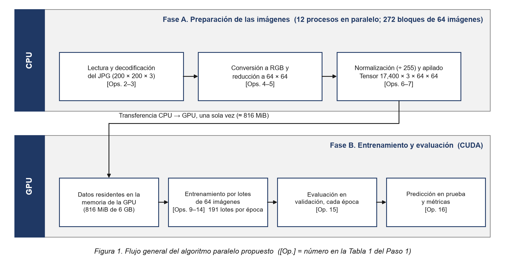
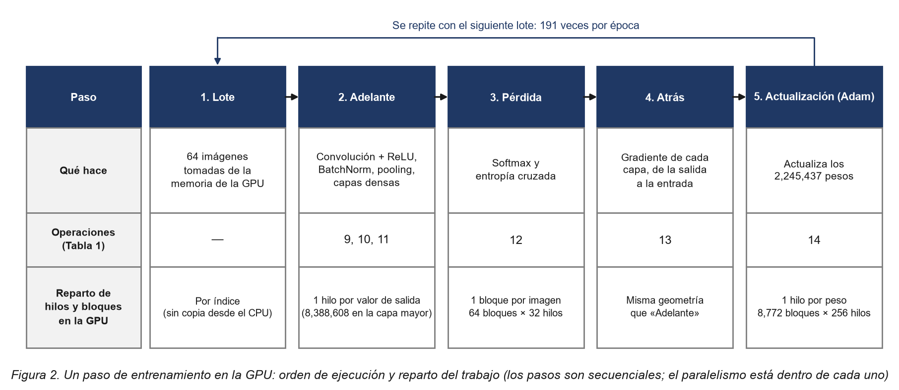
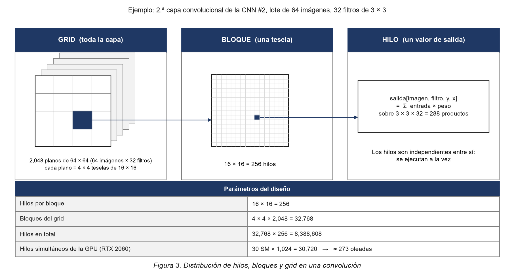

# Paso 4 — Diseño del algoritmo paralelo

Propuesta con CUDA basada en las operaciones elegidas en el Paso 3: las imágenes se preparan en el CPU y la
matemática de la red se ejecuta en la GPU, con una sola copia de datos entre ambas.

## 4.1 Fase A (CPU): reparto de las imágenes

* **Tareas:** bloques de 64 imágenes → `⌈17,400 / 64⌉ = 272` tareas independientes.
* **Ejecutores:** un proceso por hilo del CPU (12). Cada uno toma la siguiente tarea libre (≈ 22 por proceso).
* **Resultado:** los bloques se juntan en el mismo orden y se normalizan; la salida es idéntica a la del programa secuencial.

## 4.2 Puente: una sola copia CPU → GPU

17,400 × 3 × 64 × 64 valores de 4 bytes ≈ **816 MiB** (entrenamiento 571, validación 122, prueba 122), que caben en
los 6 GB de la GPU. Cada lote se toma después de la memoria de la GPU por índice, sin copias dentro del entrenamiento.

## 4.3 Fase B (GPU): un paso de entrenamiento

## 4.4 Distribución del trabajo entre hilos, bloques y grids

**Regla:** el tensor de salida de cada operación es el dominio del paralelismo; **cada valor de salida lo calcula un
hilo**, porque los valores de una misma capa son independientes. Los hilos se agrupan en bloques de 256 y los
bloques forman el grid.

Dimensiones de la **CNN #2**, lote de 64 imágenes:

| Operación | 1 hilo = | Bloque | Grid | Hilos |
|---|---|---|---|---:|
| Convolución 3×3 (capa 2: 32 → 32 canales, 64×64) | un valor de salida (288 productos) | 16 × 16 = 256 | (4, 4, 2048) = 32,768 | 8,388,608 |
| ReLU, Dropout, sumas | un elemento | 256 | 32,768 | 8,388,608 |
| Pooling 2×2 (salida 64×32×32×32) | un valor de salida | 256 | 8,192 | 2,097,152 |
| BatchNorm (32 canales) | un bloque por canal (reducción) | 512 | 32 | 16,384 |
| Capa densa 8192 → 256 | un valor de la matriz resultante (64 × 256) | 16 × 16 = 256 | (16, 4) = 64 | 16,384 |
| Capa densa 256 → 29 | un valor de la matriz resultante (64 × 29) | 16 × 16 = 256 | (2, 4) = 8 | 2,048 |
| Softmax + entropía cruzada | un bloque por imagen | 32 | 64 | 2,048 |
| Retropropagación, entradas | misma geometría que adelante | igual | igual | igual |
| Retropropagación, pesos de una convolución | un bloque por par (filtro, canal de entrada), reduciendo sobre las 262,144 posiciones | 256 | 32 × 32 = 1,024 | 262,144 |
| Adam (2,245,437 parámetros) | un parámetro | 256 | ⌈2,245,437 / 256⌉ = 8,772 | 2,245,437 |

* **Por qué un hilo por valor de salida:** con un hilo por imagen habría solo 64 hilos; la GPU necesita decenas de miles.
* **Por qué bloques de 256 (16 × 16):** es múltiplo de 32 (el *warp*) y forma una tesela cuadrada que permite reutilizar
  la región de entrada en memoria compartida.
* **Capacidad de la GPU (RTX 2060):** 30 multiprocesadores × 1,024 hilos = **30,720 hilos a la vez**. Las convoluciones, el
  pooling y Adam la superan por mucho y la mantienen ocupada; la capa densa final y la pérdida (≈ 2,000 hilos) no la llenan,
  pero pesan muy poco.
