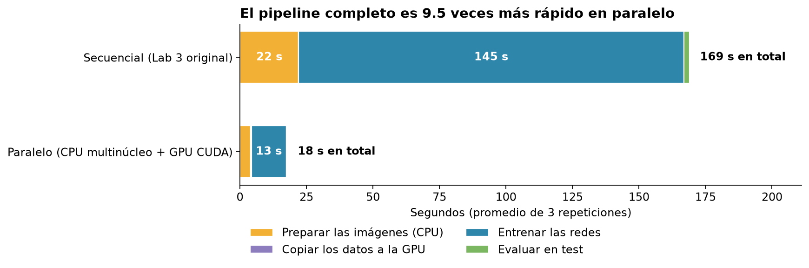
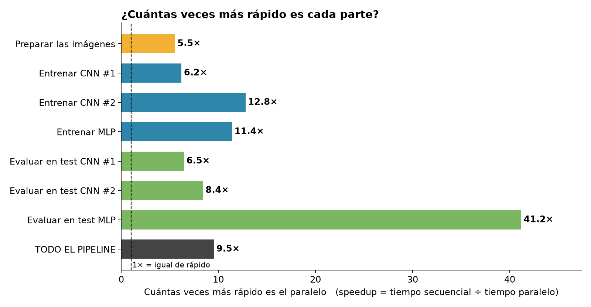
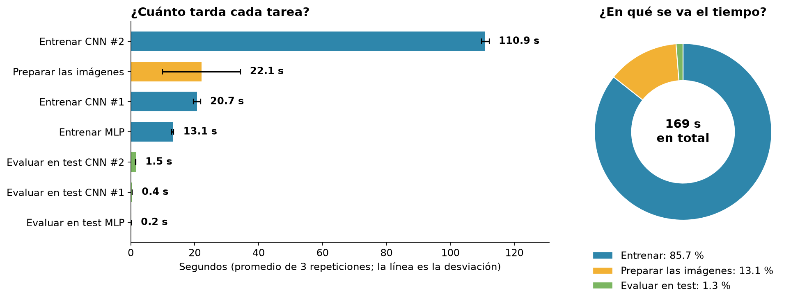
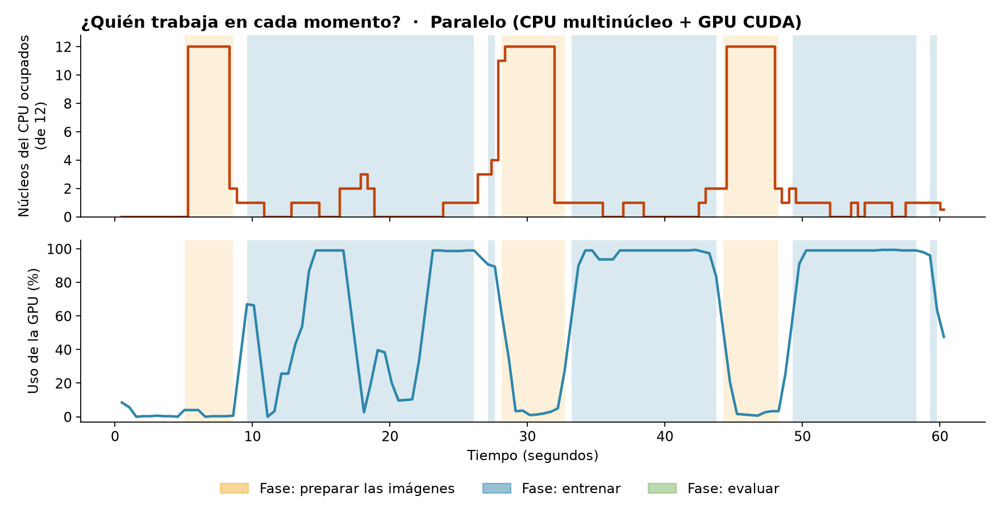
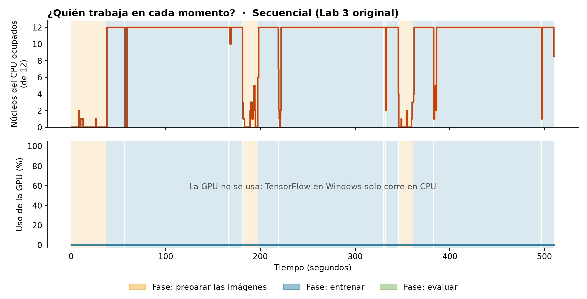

# Paso 6 — Análisis y conclusiones

Comparación de la solución secuencial del Laboratorio 3 (Keras, CPU) con la versión paralela (preparación de imágenes en
todos los núcleos del CPU + entrenamiento en GPU con CUDA). **Ambas se midieron en el mismo equipo (`pc2`), con los
mismos datos y parámetros**, de modo que el cociente entre ellas (speedup) mide solo el efecto de la paralelización.

## 6.1 Equipo y protocolo de medición

| | |
|---|---|
| CPU | Intel Core i5-12400 · 6 núcleos / 12 hilos |
| GPU | NVIDIA GeForce RTX 4060 Ti · 8 GB · 34 multiprocesadores (SM) · capacidad de cómputo 8.9 |
| RAM / SO | 31.7 GB · Windows 11 |
| Software | Python 3.12 · secuencial: TensorFlow 2.21 / Keras 3.15 (sin GPU en Windows nativo) · paralelo: PyTorch 2.11 + CUDA 12.8 |
| Datos | 17,400 imágenes de la muestra del Lab 3 (12,180 entrenamiento, 2,610 validación, 2,610 prueba), 64 × 64 × 3 |
| Parámetros | 3 épocas fijas, lote de 64, mismos hiperparámetros del Lab 3, 3 repeticiones por versión |

Datos crudos: `results/benchmark_pc2_keras_original.csv` y `results/benchmark_pc2_cuda.csv`. Tablas y gráficos generados
con `comparacion/comparar.py` (`results/tabla_comparativa_pc2.md`, `results/figures/`).

**Qué entra en el tiempo del paralelo:** preparar las imágenes (CPU), la copia de los datos a la GPU (transferencia
CPU → GPU, 816 MiB), el entrenamiento y la evaluación, con `torch.cuda.synchronize()` antes de cada lectura del reloj
(los kernels CUDA son asíncronos). **Qué no entra:** la inicialización única de CUDA (contexto + autotune de cuDNN),
**5.0 s**, que se mide aparte (`cuda_warmup`) y se paga una sola vez al abrir el programa.

## 6.2 Comparación de tiempos y speedup

Tiempo en segundos, media ± desviación estándar de 3 repeticiones. *Speedup = tiempo secuencial ÷ tiempo paralelo.*

| Fase | Modelo | Secuencial (s) | Paralelo CUDA (s) | **Speedup** |
|---|---|---:|---:|---:|
| Preparar las imágenes (CPU) | — | 22.08 ± 12.20 | 3.99 ± 0.43 | **5.53×** |
| Copiar los datos a la GPU | — | — | 0.30 ± 0.05 | (solo existe en el paralelo) |
| Entrenar | CNN #1 | 20.70 ± 1.14 | 3.34 ± 1.73 | **6.20×** |
| Entrenar | CNN #2 | 110.92 ± 1.19 | 8.67 ± 2.66 | **12.80×** |
| Entrenar | MLP | 13.11 ± 0.34 | 1.15 ± 0.03 | **11.40×** |
| Evaluar en test | CNN #1 | 0.41 ± 0.02 | 0.06 ± 0.00 | 6.47× |
| Evaluar en test | CNN #2 | 1.55 ± 0.04 | 0.18 ± 0.00 | 8.43× |
| Evaluar en test | MLP | 0.17 ± 0.00 | 0.004 | ≈ 41× (ver nota) |
| **TOTAL del pipeline** | | **168.94 ± 9.77** | **17.70 ± 4.00** | **9.55×** |

*Nota sobre «Evaluar MLP»: dura 4 ms, tan poco que el cociente es muy sensible a cualquier variación; no se debe leer
como una aceleración real de 41×.*

### Dos salvedades que afectan las cifras

1. **Repetición 1 del secuencial (preparación de imágenes).** Tardó 36.2 s y las repeticiones 2 y 3 tardaron 15.2 y
   14.9 s. Las imágenes están en un disco duro (HDD) y en la primera lectura no estaban en la caché del sistema; el
   script secuencial no calienta la caché, el paralelo sí (`warm_file_cache`). De ahí la desviación de ±12.2 s.
2. **Repetición 1 del paralelo (entrenamiento).** La CNN #1 tardó 5.3 s y la CNN #2 11.7 s, contra 2.3 s y 7.1 s en las
   repeticiones 2 y 3 (que coinciden casi exactamente entre sí). La explicación probable es que la GPU venía de reposo y
   tardó en subir de frecuencia; **es una hipótesis, no se verificó.**

Por eso se reporta también la comparación con ambos equipos «en caliente» (repeticiones 2 y 3 de cada versión):

| Fase | Modelo | Secuencial reps 2-3 (s) | Paralelo reps 2-3 (s) | Speedup |
|---|---|---:|---:|---:|
| Preparar las imágenes | — | 15.04 | 4.22 | 3.56× |
| Entrenar | CNN #1 | 21.36 | 2.34 | 9.13× |
| Entrenar | CNN #2 | 111.55 | 7.13 | **15.64×** |
| Entrenar | MLP | 13.21 | 1.13 | 11.67× |
| **TOTAL** | | **163.30** | **15.39** | **10.61×** |

**Conclusión de la comparación:** la paralelización redujo el tiempo total de **169 s a 18 s** (9.5×; 10.6× en
condiciones de equipo caliente). El mayor beneficio está en entrenar, y dentro de eso en la CNN #2, la red con más
cálculo (12.8× a 15.6×). La preparación de imágenes mejora menos (3.6× a 5.5×).

## 6.3 Por qué el speedup tiene este valor

**Ley de Amdahl.** En el secuencial, entrenar y evaluar son el 86.9 % del tiempo (144.7 + 2.1 de 168.9 s). Si solo esa
parte se acelerara, el máximo sería 1 / (1 − 0.869) ≈ **7.6×**. Se obtuvo 9.55× porque *además* se paralelizó la
preparación de imágenes (el otro 13 %); sin ese segundo cambio no se habría pasado de 7.6×.

**El cuello de botella cambió de lugar.** En el paralelo, la preparación de imágenes ya es el **22.6 %** del total
(3.99 de 17.70 s) y entrenar el 74.4 %. Entrenar pasó de ser el 85.7 % del tiempo a ser el 74.4 % de un tiempo 9.5 veces
menor; lo siguiente a optimizar sería la preparación.

**Causas por fase:**

| Fase | Causa de la diferencia |
|---|---|
| Entrenar (6× a 15×) | Las convoluciones, capas densas y la actualización de Adam son millones de operaciones independientes sobre tensores; la GPU las reparte en miles de hilos (34 SM × hasta 1,536 hilos residentes = 52,224 hilos a la vez), mientras que el CPU dispone de 12 hilos. La CNN #2 gana más porque tiene más aritmética por imagen (≈ 118.9 millones de multiplicaciones, 4.9 veces la CNN #1), y hay más trabajo que repartir entre los hilos de la GPU. |
| Entrenar CNN #1 (6.2×) | Es una red pequeña: con menos cálculo por lote, el costo fijo de lanzar kernels pesa más y la GPU se aprovecha menos. |
| Preparar imágenes (3.6× a 5.5×) | Se reparte en 12 procesos, pero el CPU tiene 6 núcleos físicos (los 12 hilos comparten recursos), decodificar JPEG no escala perfecto, y arrancar los procesos y juntar los resultados tiene costos fijos. Además depende del disco. |
| Evaluar (6× a 8×) | Mismo cálculo de la propagación hacia adelante, ya con los datos en la memoria de la GPU. |
| Copia a la GPU | 816 MiB en 0.30 s (≈ 2.7 GB/s), el 1.7 % del tiempo. Se hace una sola vez, no por lote. |

El speedup de cada fase depende también de qué tan buena sea la referencia: el MLP, por ejemplo, mejora 11× en parte
porque en el secuencial era lento para lo poco que calcula, no solo por mérito de la GPU.

## 6.4 Evidencia de uso de los recursos

Cada fase usa el hardware que le corresponde. Promedios de los logs automáticos (`logs/resources_pc2_*.csv`, CPU por
núcleo con `psutil` y GPU con NVML):

| Versión | Fase | CPU | Núcleos > 50 % | GPU |
|---|---|---:|---:|---:|
| Secuencial | Preparar imágenes | 20 % | 0 de 12 | 4 % |
| Secuencial | Entrenar | 91 % | 12 de 12 | 5 % (no usa la GPU) |
| Paralelo | Preparar imágenes | 84 % | **12 de 12** | 2 % |
| Paralelo | Entrenar | **18 %** | 0 de 12 | **76 %** (80 % medio, picos de 100 %) |

La VRAM máxima durante el entrenamiento fue de ≈ 4.4 GB (incluye ≈ 1.2 GB que ya usa Windows); la GPU llegó a ~124 W y 59 °C.

**Capturas de pantalla** (`evidencia/`):

| Captura | Qué muestra |
|---|---|
| `pc2_secuencial_preparando_cpu.png` | Inicio de la preparación (CPU 22 %, disco D: activo): carga baja, no los 12 núcleos |
| `pc2_secuencial_entrenando_cpu.png` | Entrenamiento secuencial: los 12 núcleos casi al 100 % |
| `pc2_secuencial_entrenando_gpu.png` | GPU en 0 % durante el secuencial (Keras en Windows no la usa) |
| `pc2_paralelo_preparando_cpu.png` | Pico simultáneo en los 12 núcleos durante la preparación en paralelo |
| `pc2_paralelo_entrenando_gpu.png` | GPU al 93 %, 3.0 GB de VRAM dedicada y CPU en 11 % |
| `pc2_paralelo_entrenando_nvidia-smi.png` | `nvidia-smi`: GPU al 99 %, memoria de 1.3 a 5.1 GB, ≈ 121 W |

> En el Administrador de Tareas de este equipo, el trabajo de CUDA aparece en el panel **«3D»** de la GPU (el menú no
> ofrece un motor «Cuda» separado); `nvidia-smi` confirma la misma carga. En el secuencial, el Administrador de Tareas
> no muestra «un solo núcleo» limpio porque Windows va rotando el único hilo entre los 12 núcleos; la evidencia
> cuantitativa de que solo trabaja ~1 núcleo son los logs de la tabla anterior.

## 6.5 Kernel CUDA propio (Numba, «CUDA Python» explícito)

Además de las bibliotecas, se implementó un kernel propio para el paso de **Adam** (operación 14 del diseño) en
`paralelo_cuda/kernel_adam_numba.py`, con la geometría de la tabla del Paso 4: **un hilo por parámetro, bloques de 256
hilos, ⌈N / 256⌉ bloques** (para la CNN #2, N = 2,245,437 → 8,772 bloques si fuera un solo lanzamiento; en la
implementación se lanza un kernel por tensor de parámetros, 26 en total). Comparte memoria con PyTorch sin copiarla
(`numba.cuda.as_cuda_array`).

| | Resultado (`results/kernel_adam_numba_pc2.csv`) |
|---|---|
| Validación contra `torch.optim.Adam` (10 pasos) | error máximo absoluto **2.2 × 10⁻⁸** → correcto |
| Tiempo por paso, `torch.optim.Adam` | 0.38 ms |
| Tiempo por paso, kernel de Numba | 3.91 ms (≈ 10× más lento) |

El kernel es correcto pero **más lento** que el optimizador de PyTorch. Es coherente con que el costo está en lanzar 26
kernels por paso desde Python (más la preparación de argumentos de Numba) y no en el cálculo; PyTorch agrupa esas
actualizaciones. No se verificó con un perfilador.

**Integrado en el entrenamiento (variante).** El kernel también se conectó al bucle de entrenamiento
(`python paralelo_cuda/medir_cuda.py --mode cuda --adam numba --tag pc2_numba`, resultados en
`results/benchmark_pc2_numba_cuda.csv`). Las mediciones oficiales de las secciones anteriores siguen usando
`torch.optim.Adam`. Entrenamiento de 3 épocas, media en segundos (mismas condiciones, pc2):

| Modelo | `torch.optim.Adam` (3 reps) | Kernel Numba (3 reps) | `torch.optim.Adam` (reps 2-3) | Kernel Numba (reps 2-3) |
|---|---|---|---|---|
| CNN #1 | 3.34 | 4.29 | 2.34 | 2.94 |
| CNN #2 | 8.67 | 9.94 | 7.13 | 8.21 |
| MLP | 1.15 | 1.52 | 1.13 | 1.67 |

Con el kernel propio el entrenamiento completo es entre ~15 % y ~48 % más lento, mucho menos que el 10× del
microbenchmark: en el bucle real, parte del costo de lanzamiento queda oculto detrás del cómputo de la red. Aun así
sigue sin superar al optimizador de PyTorch, y el speedup total frente a Keras se mantiene en el mismo orden de magnitud.
Los accuracies tras 3 épocas varían entre corridas (no se investigó la causa) y no son el objeto de esta comparación. Requisitos del entorno: `numba-cuda[cu12]` con NumPy < 2.4, y cargar `nvJitLink`
antes de importar `torch` (si no, el enlazado falla); `medir_cuda.py` lo hace solo con `--adam numba`.

## 6.6 Discusión técnica

### ¿Por qué procesar las imágenes con los núcleos del CPU y delegar *exclusivamente* la matemática de la red a la GPU?

* **Leer archivos lo hace el sistema operativo, no la GPU.** El disco y las rutas de archivo son del CPU; la GPU no abre
  archivos.
* **Decodificar JPEG tiene muchas bifurcaciones y poca aritmética por dato**, justo lo contrario de lo que la GPU hace
  bien (mucha aritmética regular sobre muchos datos). Cada imagen es independiente, así que se reparte entre procesos
  del CPU sin comunicación entre ellos.
* **Se hace una sola vez**, no en cada época. Mover esa lógica a la GPU complicaría el código para acelerar una fase
  que ya pesa poco.
* **La matemática de la red sí encaja con la GPU:** convoluciones, multiplicaciones de matrices, BatchNorm, pérdida y
  Adam son operaciones sobre millones de valores independientes, y se repiten en cada lote de cada época.
* **Cada recurso trabaja en su fase y nunca compiten:** los logs lo muestran (CPU 84 % / GPU 2 % al preparar; CPU 18 % /
  GPU 76 % al entrenar). La única copia entre ambos son 816 MiB, una vez (1.7 % del tiempo); desde ahí cada lote se
  toma de la memoria de la GPU sin volver a pasar por el CPU.

### ¿Cómo permitió CUDA reducir o cambiar el tiempo de procesamiento?

Cambió **dónde y cómo** se hace el cálculo: en lugar de 12 hilos del CPU, la GPU ejecuta decenas de miles de hilos que
calculan a la vez los valores de cada capa (la convolución más grande de la CNN #2 tiene 8.4 millones de valores de
salida independientes por lote). Esto redujo el entrenamiento de 144.7 s a 13.2 s (11×) y el total de 168.9 s a 17.7 s
(9.5×). Además, al ser el entrenamiento mucho más rápido, **cambió el perfil del programa:** la preparación de imágenes
pasó de ser el 13 % al 22.6 % del tiempo.

### ¿Qué factores justifican o limitan la utilización de CUDA?

| Justifican | Limitan |
|---|---|
| Mucho cálculo por dato (la CNN #2 gana 12.8× a 15.6×) | Redes pequeñas o poco cálculo: el costo fijo de lanzar kernels pesa más (CNN #1: 6.2×; MLP evaluando: 4 ms) |
| Operaciones independientes sobre tensores grandes | Fracción no acelerable (Amdahl): preparar imágenes, control del programa |
| Datos que caben en la VRAM y se copian una sola vez (816 MiB de 8 GB) | Si no caben, o se copian por lote, la transferencia CPU ↔ GPU domina |
| El mismo cálculo se repite en cada lote y época (el costo de arrancar se amortiza) | **Costos de arranque:** 5.0 s de inicialización de CUDA; en un entrenamiento de 18 s ya pesan |
| Bibliotecas maduras (cuDNN, cuBLAS) ya optimizadas | Hardware: requiere GPU NVIDIA y driver; en Windows, TensorFlow ≥ 2.11 no la usa, por lo que fue necesario portar las redes a PyTorch |
| | Un kernel propio (Numba) no es automáticamente mejor: el de Adam resultó 10× más lento que el de PyTorch |

## 6.7 Funciones y librerías que permiten trabajar con la GPU

| Librería / función | Para qué se usó |
|---|---|
| **PyTorch con CUDA 12.8** (`torch.cuda`, `tensor.to("cuda")`) | Ejecuta las redes y el entrenamiento en la GPU desde Python; transferencia CPU → GPU |
| **cuDNN** | Convoluciones, BatchNorm y pooling (PyTorch delega en ella; se activa `torch.backends.cudnn.benchmark = True`, que elige el algoritmo más rápido en el calentamiento) |
| **cuBLAS** | Multiplicación de matrices de las capas densas (PyTorch delega en ella) |
| `torch.cuda.synchronize()` | Esperar a que la GPU termine antes de leer el reloj (los kernels son asíncronos) |
| `torch.randperm(..., device="cuda")` e indexación en GPU | Mezclar y extraer los lotes sin volver al CPU |
| **Numba CUDA** (`numba.cuda.jit`, `as_cuda_array`) y `numba-cuda[cu12]` | Kernel propio de Adam (6.5) |
| **NVML** (`nvidia-ml-py`) | Monitoreo de uso de GPU, VRAM, potencia y temperatura (mismos datos que `nvidia-smi`) |
| `psutil` | Uso de CPU por núcleo |
| `concurrent.futures.ProcessPoolExecutor` | Repartir las imágenes entre los núcleos del CPU (procesos, no hilos: la decodificación de JPEG no se beneficia de los hilos de Python) |
| `nvidia-smi` y Administrador de Tareas | Evidencia de ejecución (6.4) |

## 6.8 Limitaciones

* **Solo 3 épocas.** Los tiempos miden trabajo por unidad, no la calidad del modelo. Con 3 épocas las redes no han
  convergido, y como PyTorch y Keras inicializan de forma distinta, las precisiones no son comparables entre sí
  (por ejemplo, CNN #2 en validación: 0.41 en PyTorch contra 0.23 en Keras). La referencia de calidad del Lab 3 (CNN #1
  94.2 %, CNN #2 98.0 %) corresponde a un entrenamiento completo, que no se repitió aquí.
* **Una sola máquina** para este análisis. Las mediciones de la otra plataforma (`pc1`, i7-10750H + RTX 2060) quedan en
  el repositorio como segunda referencia, pero no se mezclan con estas cifras.
* **Tres repeticiones** son pocas: la desviación del paralelo (±4.0 s sobre 17.7 s) está dominada por la repetición 1.
* El diseño de hilos y bloques de `docs/04` se calculó para una RTX 2060 (30 SM); esta GPU tiene 34 SM. Las cifras de
  geometría por operación no cambian; solo la capacidad de hilos simultáneos.
